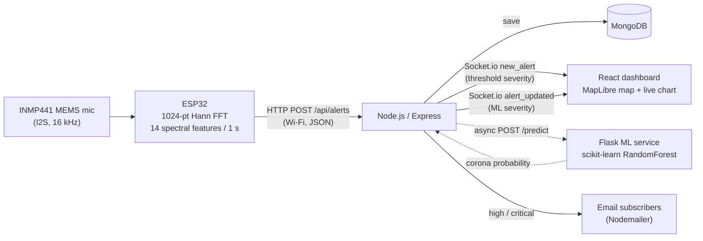

# VoltVigil

An ESP32 sensor node listens for the acoustic signature of corona discharge on power lines, and a real-time dashboard flags likely faults on a map before they turn into outages.


> 🥈 **2nd place, Bitcamp 2026 (Real World Problems track)**

## Demo

- **Video:** TODO: add demo video link
- **Dashboard screenshot:** TODO: add `docs/dashboard.png` and embed it here

## The problem

Corona discharge, the partial ionisation of air around damaged or contaminated high-voltage hardware, is an early warning sign of insulator and conductor failure, which can lead to outages and wildfires. Utilities usually find it with periodic manual patrols and expensive ultrasonic or UV cameras, so faults can develop unnoticed between inspections. VoltVigil explores whether a low-cost, always-on acoustic sensor can catch these signatures continuously.

## How it works



1. The **ESP32** reads the INMP441 over I2S, runs a 1024-point FFT on each frame, and averages 14 normalised spectral features over one second.
2. It **POSTs** the features and its location to the backend about once a second.
3. The **backend** assigns an immediate rule-based severity, saves the reading to MongoDB, and pushes it to every dashboard over Socket.io without waiting for the classifier.
4. In the background it calls the **ML service**, which returns a corona-discharge probability. The backend then updates the record and pushes an `alert_updated` event.
5. For **high/critical** results it emails subscribers, with a 5-minute cooldown per sensor. Without Gmail credentials it runs in **mock email** mode: messages are built and logged, and the notification log fills in, but nothing is sent.

## Hardware

**Parts**

| Part | Notes |
|---|---|
| ESP32 dev board | Any ESP32 with Wi-Fi and the I2S peripheral |
| INMP441 I2S MEMS microphone breakout | Digital output; no ADC needed |
| 3D-printed enclosure | [`hardware/housing/Housing.stl`](hardware/housing/Housing.stl) + [`Cap.stl`](hardware/housing/Cap.stl) |
| USB cable / 5 V supply | Powers the ESP32 |

**Wiring** (from the pin definitions in [`firmware/Pipeline/Pipeline.ino`](firmware/Pipeline/Pipeline.ino))

| INMP441 pin | ESP32 pin | Purpose |
|---|---|---|
| `SCK` | GPIO 14 | I2S bit clock |
| `WS` | GPIO 15 | I2S word select (L/R clock) |
| `SD` | GPIO 32 | I2S serial data in |
| `L/R` | GND | Selects the left channel; firmware reads `I2S_CHANNEL_FMT_ONLY_LEFT` |
| `VDD` | 3V3 | Power |
| `GND` | GND | Ground |

## Signal processing and ML

**On the ESP32** ([`firmware/Pipeline`](firmware/Pipeline/Pipeline.ino))

| Parameter | Value |
|---|---|
| Sample rate | 16 kHz, 32-bit I2S samples (shifted down 8 bits) |
| FFT size | 1024 points (~15.6 Hz per bin), using `arduinoFFT` |
| Window | Hann |
| Features (14) | Mean magnitude around 80, 100, 120, 180, 200, 220, 280, 300 and 320 Hz (3-bin average), plus band averages for 20–80, 80–140, 170–230, 270–330 and 800–4000 Hz |
| Normalisation | Each feature divided by the total spectral energy of its frame |
| Aggregation | Averaged over all frames in a 1-second window, then smoothed with an EMA (α = 0.7) |

The narrow bands target the hum at the 2nd, 4th and 6th harmonics of 50 Hz mains (100/200/300 Hz). The 800–4000 Hz band captures the broadband hiss and crackle of discharge.

**Classifier** ([`ml/train.py`](ml/train.py), [`ml/app.py`](ml/app.py))

- **Data:** [`ml/corona_audio_dataset_labeled.csv`](ml/corona_audio_dataset_labeled.csv) holds **46 labelled samples**, each a 10-second feature average recorded with the INMP441. There are 19 corona samples (recorded close to the mic and at 5 cm) and 27 non-corona samples (background, highway traffic, strong wind). The samples were collected with [`firmware/Calibration_randomforest`](firmware/Calibration_randomforest/Calibration_randomforest.ino).
- **Training:** each sample gets 8 extra copies with small Gaussian noise added (5% of the sample's std), giving 414 rows. The script then trains a RandomForest (300 trees, depth 8, balanced classes) and a GradientBoosting model, keeps whichever scores higher on an 80/20 split, and saves it to `corona_rf_model.pkl`.
- **Serving:** a Flask service on port 5001 exposes `POST /predict`. It maps the corona probability to a severity: ≥ 0.70 critical, ≥ 0.50 high, ≥ 0.35 medium, otherwise low.
- **Fallback:** if the ML service is down, alerts keep the backend's rule-based severity.

[`firmware/Raw_signal_calibration`](firmware/Raw_signal_calibration/Raw_signal_calibration.ino) is a standalone on-device heuristic: a harmonic-to-hiss ratio printed over serial. It was used to calibrate the features.

## Results

| Metric | Result | How to reproduce |
|---|---|---|
| Classifier accuracy | **95.6% ± 5.4%**: 5-fold stratified cross-validation on the 46 real (non-augmented) samples | `cd ml && python train.py` |
| Alert latency, backend → dashboard (local) | **~5 ms median** for the first alert; **~156 ms median, < 210 ms max** for the ML-classified update | `cd backend && npm run latency` (backend + ML service running) |
| Sensor nodes on the dashboard | 1 hardware node + 3 simulated nodes | [`frontend/src/data/sensorNodes.js`](frontend/src/data/sensorNodes.js) |

Caveats:
- The dataset is small, so the CV score has wide variance.
- `train.py` also prints 100% accuracy on its held-out split. That figure is inflated because augmented copies of the same recording land in both the training and test sets, so the CV number above is the honest one.
- Latency was measured on one machine over loopback (30–50 requests). It does not include the ESP32's Wi-Fi hop or its 1-second feature window.

## Tech stack

| Layer | Technologies |
|---|---|
| Firmware | C++ (Arduino), ESP32 I2S driver, `arduinoFFT`, `ArduinoJson`, `WiFi` / `HTTPClient` |
| ML | Python, scikit-learn, pandas, NumPy, joblib, Flask, flask-cors |
| Backend | Node.js, Express 4, Socket.io 4, MongoDB + Mongoose 8, Nodemailer, dotenv |
| Frontend | React 18, Vite 5, Tailwind CSS 3, MapLibre GL (CARTO basemap), Recharts, socket.io-client, axios, Three.js, cobe, Motion |
| Hardware | ESP32, INMP441, 3D-printed housing |

## Repository layout

```
firmware/   ESP32 sketches: Pipeline (deployed node), calibration and data-collection sketches
ml/         Training script, Flask inference service, labelled dataset
backend/    Express + Socket.io API, MongoDB models, email alerts, simulator scripts
frontend/   React dashboard
hardware/   Enclosure STL files
```

## Local setup

No ESP32 or email account needed: the [no-hardware mode](#running-without-hardware) simulates the sensor, and email runs in mock mode by default.

**Prerequisites:** Node.js 18+, Python 3.10+, MongoDB (local or Atlas), and Arduino IDE 2 for the firmware.

### 1. ML service

```bash
cd ml
python -m venv .venv
source .venv/bin/activate        # Windows: .venv\Scripts\activate
pip install -r requirements.txt
python train.py                  # writes corona_rf_model.pkl
python app.py                    # http://localhost:5001
```

Run both scripts from inside `ml/`, because they use relative file paths.

### 2. Backend

```bash
cd backend
npm install
cp .env.example .env             # set MONGO_URI; leave EMAIL_* empty for mock email
npm run dev                      # http://localhost:5000
```

On startup the server prints the LAN URL the ESP32 should post to.

### 3. Frontend

```bash
cd frontend
npm install
cp .env.example .env             # VITE_API_URL, defaults to http://localhost:5000
npm run dev                      # http://localhost:5173
```

### 4. Firmware (optional, needs an ESP32 + INMP441)

1. In the Arduino IDE, install the **esp32** board package (Espressif). The sketch uses the legacy `driver/i2s.h` API from core 2.x; newer cores may print deprecation warnings.
2. Install the **arduinoFFT** (v2.x) and **ArduinoJson** libraries from the Library Manager.
3. Copy `firmware/Pipeline/secrets.example.h` to `firmware/Pipeline/secrets.h` and fill in your Wi-Fi credentials and backend URL. `secrets.h` is gitignored.
4. Optionally, edit `lat` / `lng` in `Pipeline.ino` to set the node's map location.
5. Open `firmware/Pipeline/Pipeline.ino`, select your ESP32 board and port, and upload. The Serial Monitor runs at 115200 baud.

### Running without hardware

With MongoDB, the ML service, the backend and the frontend running:

```bash
cd backend
npm run simulate                 # options: --url http://localhost:5000 --interval 1000
```

This replays rows from the labelled dataset, with ±5% jitter, as live readings from `sensor-01`. Subscribe an address on the Notifications tab to see mock alert emails in the backend log. They go through the full pipeline (rule-based severity, ML classification, Socket.io updates, map and chart). The three simulated map nodes are static demo data in the frontend.

## What I'd improve next

- **More data and a leak-free evaluation.** 46 samples from one microphone and one session is a proof of concept. Next steps: split before augmenting, hold out whole recording sessions, and collect real field recordings near energised lines.
- **Configurable mains frequency and node identity.** The features assume 50 Hz harmonics (100/200/300 Hz), but US mains is 60 Hz (120/240/360 Hz). The firmware also sends no `nodeId` and hardcodes its coordinates, so every device appears as `sensor-01`, and the dashboard's node list is fixed in code.
- **Separate readings from alerts.** Every 1-second reading is stored as an "alert" (about 86k documents per node per day). The "peak frequency" shown is estimated from band energies rather than taken from the actual FFT peak. A real system would store readings as a time series and raise alerts only on state changes.
- **Production hardening.** The API has no authentication and allows any CORS origin, so anyone who can reach it can post or delete alerts and subscribers. There are also no automated tests or CI.

## Team and my role

This was built by a team at Bitcamp 2026.

- **Team:** TODO: list teammates and link their GitHub profiles
- **My role:** TODO: describe what you personally built (for example backend, dashboard, ML pipeline, firmware)

## License

[MIT](LICENSE)

---

Built by **Harshith Bachimanchi** · [harshith@umd.edu](mailto:harshith@umd.edu)
